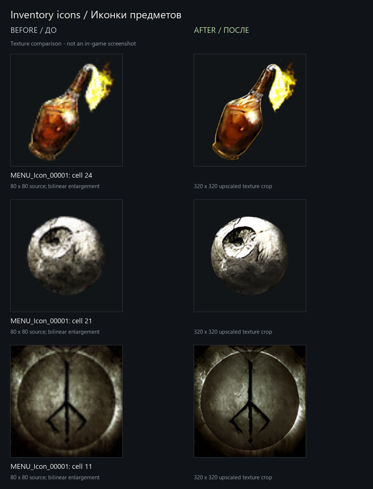
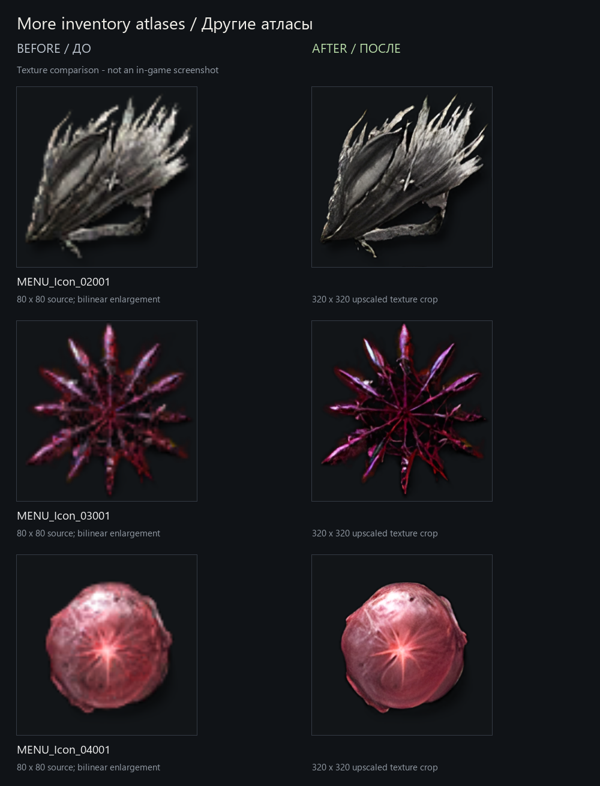
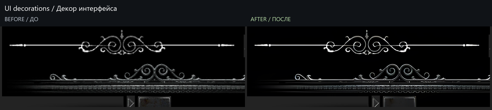

# Bloodborne UI 4K

[English](README.md) · [Проверки и совместимость](docs/TESTING.md) · [Источники и авторы](THIRD_PARTY_NOTICES.md)

Улучшенные текстуры интерфейса, иконки предметов и отрисовка текста в 4К для **bbport от Jgamrot, Launcher 1.9.7**.

## До / после

Ниже — **сравнения настоящих текстур, а не скриншоты игры**. Слева и справа показана одна область в одинаковом экранном размере. Исходные иконки увеличены билинейной фильтрацией; дополнительная резкость не применяется. Крупные фрагменты предназначены для сравнения деталей: в игре значки сохраняют прежний размер. Старое сравнение декора интерфейса сохранено из разработки. [Координаты и методика](docs/images/comparison-method.json).

### Иконки предметов



### Другие атласы инвентаря



### Декор интерфейса



## Что входит

- **UI 4K:** 40 текстур интерфейса увеличены в 2 раза по каждой стороне; 79 файлов Scaleform GFX согласованы с новыми размерами, чтобы сохранить расположение элементов.
- **Inventory Icons 4K:** все 20 атласов `MENU_Icon` увеличены в 4 раза по каждой стороне. Стандартные 1024×1024 стали 4096×4096; прямоугольные атласы сохранили пропорции.
- **Исправление координат:** иконки остаются целыми, в своих ячейках и обычного размера.
- **Отрисовка текста в 4К:** область отрисовки меню согласована с 3840×2160. Сами шрифты остались исходными векторными; это не набор новых шрифтов.
- Подсказки клавиатуры и мыши **PCBButtons** включены в комплект.
- Установка и удаление в одном окне с русским и английским интерфейсом. Проверка выбранной папки выполняется автоматически. Устанавливать Python или запускать от администратора не требуется, если папка bbport доступна для записи.

## Совместимость

| Компонент | Поддерживаемый вариант |
|---|---|
| Система | Windows 10/11, Windows PowerShell 5.1 |
| Порт | [bbport от Jgamrot 1.9.7, `qml-launcher-preview-21`](https://github.com/Jgamrot/bloodborne_pc/releases/tag/qml-launcher-preview-21) |
| Разрешение | **3840×2160** для проверенного улучшения текста |
| Подсказки | Клавиатура/мышь; совместимость с изображениями кнопок Xbox не установлена |

Установщик проверяет точные отпечатки исходных скриптов и SHA-256 штатного `bb-probe.exe`. Неизвестная или изменённая установка отклоняется до копирования файлов. Крупные иллюстрации описаний предметов и текстуры мира не увеличены.

## Установка

1. Скачай **`Bloodborne-UI-4K-v1.0.0.zip` из Releases этого проекта** и распакуй. Автоматический архив **Source code** от GitHub не содержит текстур.
2. Закрой игру **и лаунчер**.
3. Открой **`Setup.cmd`**, выбери русский или английский язык.
4. Укажи **папку bbport с `Bloodborne.exe`**, а не папку игрового дампа `CUSA03173`. Под полем пути автоматически появится результат: **зелёный текст**, если можно продолжить, или **красный текст с причиной проблемы**. Всплывающих окон нет. Когда папка пройдёт проверку, нажми **«Установить»**.
5. Запускай bbport обычным способом. Для проверенного улучшения текста выбери **3840×2160** и полностью перезапусти игру.

Установщик сам включает моды и задаёт порядок:

```text
Keyboard Prompts (PCBButtons)
UI 4K
Inventory Icons 4K
```

Записи остальных модов сохраняются. Изображения кнопок Xbox отключаются, поскольку архив интерфейса содержит клавиатурные подсказки. Установщик не меняет разрешение, назначения клавиш, сохранения, дамп игры и настройки видеодрайвера. Раскладка клавиш в лаунчере должна соответствовать изображениям подсказок.

## Удаление и обновление bbport

Открой **`Setup.cmd`**, укажи ту же папку и нажми **«Удалить»**. Исходные скрипты и существовавшие до установки файлы восстанавливаются из обычных резервных копий в `.bbport-ui4k`; добавленные установщиком файлы удаляются. Более поздние изменения выбора посторонних модов сохраняются. Не удаляй резервную папку, пока комплект установлен.

**Перед обновлением bbport сначала удали комплект.** Если обновление или ручная правка уже изменили установленный файл, удаление остановится, чтобы его не перезаписать. Сохрани изменённый файл отдельно, восстанови соответствующий файл установленного комплекта, затем повтори удаление. Не заменяй неизвестный новый скрипт старой резервной копией вслепую.

## Решение проблем

| Сообщение или симптом | Действие |
|---|---|
| Unsupported or modified bbport | Нужен чистый поддерживаемый выпуск. Установщик не перезаписывает неизвестные локальные исправления камеры или запуска. |
| Incomplete source checkout | Скачай полный ZIP установщика из Releases. |
| Ошибка проверки комплекта | Повторно распакуй архив и проверь опубликованную SHA-256. |
| На месте уже другой мод | Сохрани конфликтующий мод отдельно перед установкой. |
| Конфликт `common.tpf.dcx` при запуске | Поставь Inventory Icons 4K после UI 4K и остальных модов интерфейса: именно его архив должен загружаться последним. |
| Иконки обрезаны, сдвинуты или огромные | Проверь файлы комплекта. Одной папки текстур без исправления запуска недостаточно. |
| PowerShell запрещён политикой организации | Используй разрешённый на этом компьютере способ установки. Комплект не меняет системную политику выполнения. |

